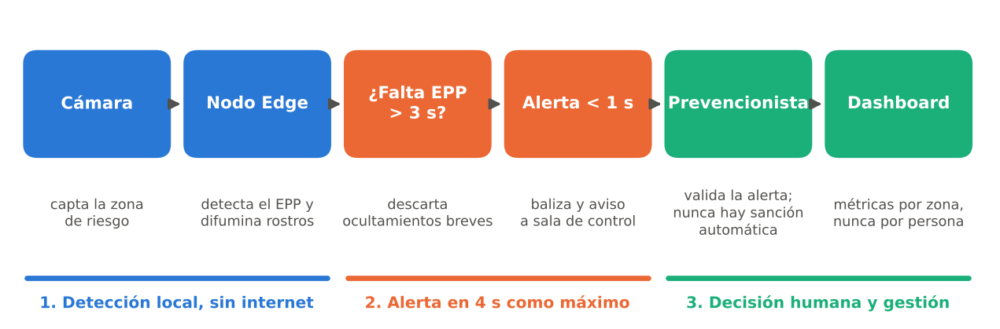
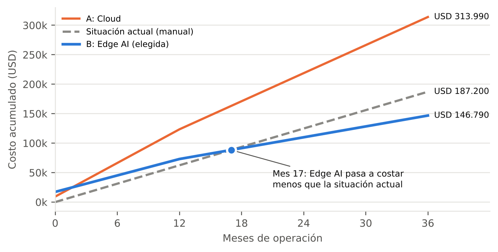
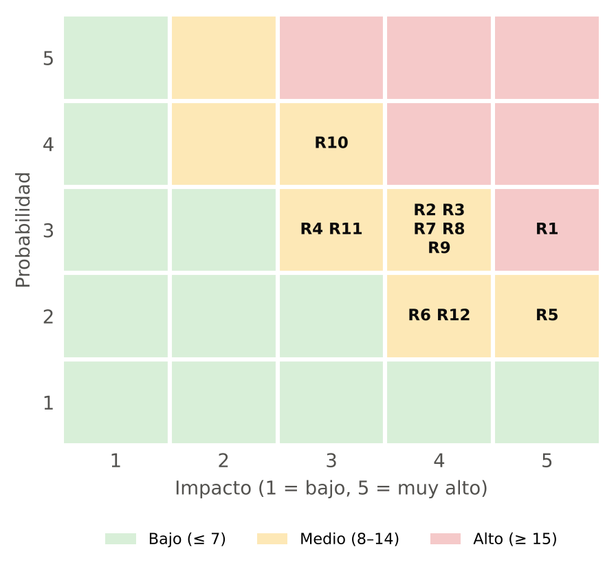
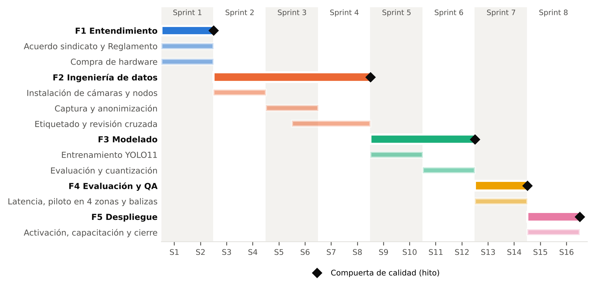
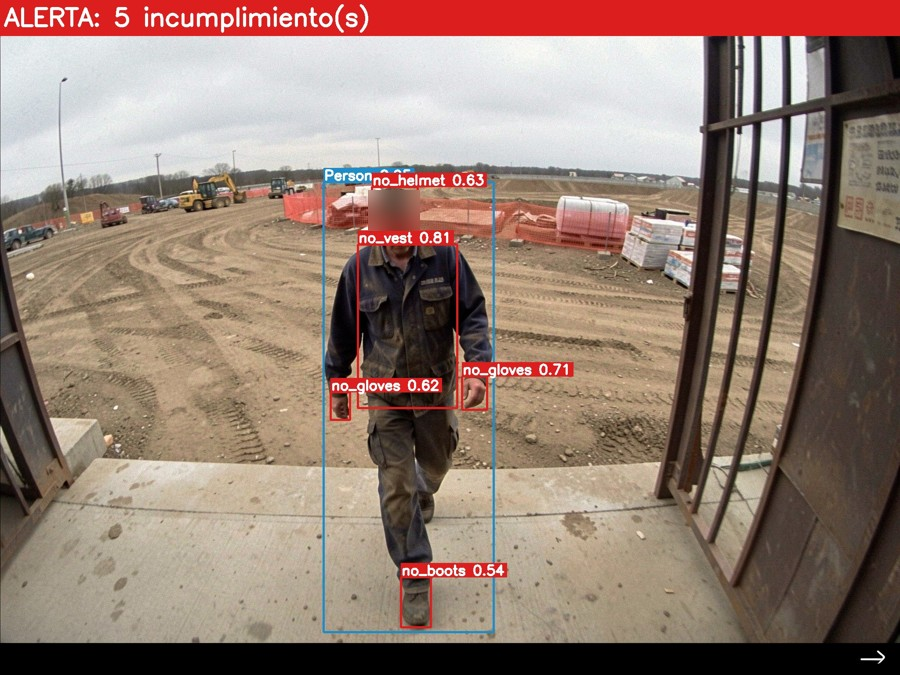

# Sistema inteligente de monitoreo de EPP

**Cámaras y Edge AI para prevenir accidentes por falta de Elementos de Protección Personal**

Gestión de Proyectos de Datos (SCY1102) · Equipo: **Johan Soto** y **Fernanda Alcaino**

| Documento | Dónde |
|---|---|
| **Plan de proyecto v4 (documento principal)** | [`Plan_de_Proyecto_EPP_v4.pdf`](Plan_de_Proyecto_EPP_v4.pdf) |
| Anexos A–F (requerimientos, finanzas, ética y legal, planificación, riesgos, trazabilidad) | [`entregables/Plan/`](entregables/Plan/) |
| Anexo G: arquitectura del sistema | [`entregables/Arquitectura_Sistema_EPP_v1.2.pdf`](entregables/Arquitectura_Sistema_EPP_v1.2.pdf) |
| Tablero de seguimiento | [Jira, proyecto ME](https://sistema-monitoreo-epp.atlassian.net/jira/core/projects/ME/board) |
| Prototipo y guía técnica | [`modelo/`](modelo/README.md) |

---

## 1. El problema

Una planta industrial mediana, con unos **200 trabajadores en 20 zonas de riesgo** y operación por
turnos, registra en promedio **2 accidentes al año** por la falta o el mal uso de EPP. La supervisión
manual no alcanza a cubrir todas las zonas ni todos los turnos, y cada accidente implica costos
humanos, multas y un mayor recargo del seguro de accidentes (Ley 16.744).

**Necesidades del cliente**

1. Detectar omisiones de EPP en tiempo real, en todas las zonas y turnos.
2. Reducir los accidentes, las multas y el recargo del seguro.
3. No vulnerar la privacidad ni generar sanciones injustas.
4. Seguir operando aunque se caiga internet.

## 2. La solución

Cada zona tiene una cámara y un nodo Edge que analiza el video **dentro de la planta**. Si un
trabajador no lleva casco o chaleco durante más de 3 segundos, se enciende una baliza local y la sala
de control recibe un aviso. **Un prevencionista revisa cada alerta: el sistema nunca sanciona por sí
solo.** No se identifica a las personas ni se mide su productividad.



**Objetivo:** implementar en **16 semanas** un sistema en las 20 zonas que alerte la omisión de
casco o chaleco en un máximo de **4 segundos**, con privacidad por diseño y validación humana.

## 3. ¿Es viable? Tres dimensiones

### Ética y legal

**Impactos éticos posibles**
- **Privacidad:** una cámara permanente puede sentirse como vigilancia extrema.
- **Estrés:** saberse observado por una IA puede aumentar la ansiedad de los trabajadores.
- **Sanciones injustas:** una falsa alarma podría terminar en un llamado de atención inmerecido.
- **Uso indebido:** que el sistema se use para controlar el rendimiento y no para prevenir accidentes.

**Sesgos**
- **Demográfico:** el modelo podría detectar peor a algunas personas o su EPP según su complexión,
  género, tono de piel o la talla del equipo.
- **De contexto:** podría funcionar bien con buena luz y fallar en zonas oscuras o en el turno de
  noche, lo que perjudicaría siempre a los mismos trabajadores.

**Mitigaciones**

| Riesgo | Medida | Se verifica en |
|---|---|---|
| Pérdida de privacidad | El video se analiza en la planta y los rostros se difuminan antes de guardar o enviar cualquier imagen | RF-03, auditoría de 500 evidencias |
| Uso como control laboral | Sin identificación ni métricas por persona; el dashboard muestra solo zona y turno | RF-06, exclusiones del alcance |
| Sanción por error del modelo | Un prevencionista valida cada alerta; nunca hay sanción automática | RF-04 |
| Sesgo por luz o turno | Al menos 20 % de imágenes nocturnas y métricas separadas por condición de luz | E4, RNF-02 |
| Sesgo demográfico | Dataset propio con trabajadores reales de la planta y recall medido por grupo antes del piloto | E4, E5 |
| Conservar datos de más | El video sin incidentes se elimina a los 30 días, con registro | RF-05 |
| Falta de transparencia | Protocolo ético acordado con el sindicato y el Comité Paritario | E2 |

**Marco legal:** Código del Trabajo (Art. 154 y 184), Ord. 2000/49883 de la Dirección del Trabajo,
Ley 21.719 de datos personales (vigente desde el 1 de diciembre de 2026), Ley 16.744 y D.S. 594.
Detalle en el [Anexo C](entregables/Plan/Anexo_C_Evaluacion_Etica_y_Legal.pdf).

### Financiera
Se compararon tres alternativas: la supervisión manual actual, una solución en la nube y la
solución Edge AI.



| Indicador (Edge AI) | Valor |
|---|---|
| Inversión | USD 17.280 (tope: USD 20.000) |
| Recuperación de la inversión | Mes 17 |
| Ahorro neto a 3 años | USD 40.410 |
| VAN al 10 % | USD 29.030 |
| Punto de equilibrio | Rentable si los accidentes bajan más de un 52 % (meta: 85 %) |

La solución en la nube cuesta más que no hacer nada. Detalle en el Anexo B.

### Gestión de riesgos
Se identificaron 12 riesgos, cada uno con responsable y señal de alerta temprana. Los que se
vigilan de cerca son los falsos negativos del modelo, el atraso del acuerdo con el sindicato, la demora
del hardware y la poca disponibilidad de los prevencionistas. Detalle en el Anexo E.



**Conclusión:** el proyecto es viable en las tres dimensiones.

## 4. Cómo se gestiona

**Metodología:** marco híbrido. **CRISP-ML(Q)** define 5 fases, con una compuerta de calidad al
cierre de cada una. **Scrum** las ejecuta en **8 sprints de 2 semanas**, con revisión del Product
Owner al final de cada sprint.



| Fase | Sprints | Entregable clave |
|---|---|---|
| F1 Entendimiento del negocio | 1 (S1–S2) | Requerimientos aprobados y acuerdo con el sindicato |
| F2 Ingeniería de datos | 2–4 (S3–S8) | Infraestructura instalada y dataset de 10.000 imágenes etiquetadas |
| F3 Modelado | 5–6 (S9–S12) | Modelo con recall ≥ 0,95 y precisión ≥ 0,90 |
| F4 Evaluación | 7 (S13–S14) | Piloto en 4 zonas |
| F5 Despliegue | 8 (S15–S16) | 20 zonas en producción, capacitación y cierre |

**Roles**

| Rol | Persona |
|---|---|
| Patrocinador | Gerencia de Operaciones (cliente) |
| Product Owner | Jefatura de Prevención de Riesgos (cliente) |
| Jefe de proyecto (Scrum Master) e ingeniero de ML | Johan Soto |
| Ingeniera de datos | Fernanda Alcaino |
| Infraestructura | Johan Soto (nodos) y Fernanda Alcaino (red) |
| Prevencionista | Valida etiquetas y alertas (64 h) |

**Seguimiento:** el [tablero de Jira](https://sistema-monitoreo-epp.atlassian.net/jira/core/projects/ME/board)
tiene 50 tareas con responsable, fechas y horas: 622 h en total (323 h de Johan y 299 h de Fernanda).
Indicadores de control: SPI ≥ 0,95, desviación de costo ≤ 5 %, cumplimiento de sprint ≥ 90 % y
recall del modelo ≥ 0,95.

## 5. Estado actual (20/11/2026, semana S3)

> La ejecución en planta aún no comienza: el avance de los sprints 1 y 2 se registra **simulado según el
> cronograma** (sección 10 del plan y Anexo D). Lo ejecutado de verdad es la prueba de concepto del prototipo.

- **Sprint 1 cerrado:** F1 completa y compuerta aprobada.
- **Sprint 2 en curso:** instalación de cámaras, nodos y red.
- **Prueba de concepto adelantada:** se construyó un prototipo funcional que detecta EPP y
  genera alertas.



| Meta del plan | Prototipo | Lectura |
|---|---|---|
| Precisión ≥ 0,90 | **0,91** | Cumple: casi no da falsas alarmas |
| Recall ≥ 0,95 | 0,50 sin casco / 0,58 sin chaleco | No cumple aún: se espera con el dataset propio (F2) y el entrenamiento completo (F3) |
| Latencia < 1 s | **38 ms** por imagen en PC | Cumple; falta medirla en el nodo Edge |

El prototipo usa un dataset público de 1.000 imágenes. Su función es validar el enfoque técnico
temprano, no reemplazar las fases del plan. Detalle técnico en [`modelo/`](modelo/README.md).

## 6. Estructura del repositorio

```
ProyectoEPP/
├── Plan_de_Proyecto_EPP_v4.pdf   documento principal
├── README.md                     esta página (visión de negocio y gestión)
├── entregables/
│   ├── Plan/                     anexos A–F en PDF
│   ├── Arquitectura_Sistema_EPP_v1.2.pdf   anexo G
│   ├── editables/                versiones Word de todos los documentos
│   ├── arquitectura_diagramas/   figuras de la arquitectura
│   └── presentacion_imagenes/    gráficos para la presentación
└── modelo/                       prototipo de detección (README técnico, código, pesos y evidencia)
```

Para ejecutar la demo del prototipo con la cámara web, haz doble clic en `Iniciar_Demo_EPP.bat`
(la primera vez prepara el entorno solo). Más detalles en la [guía técnica del modelo](modelo/README.md).
